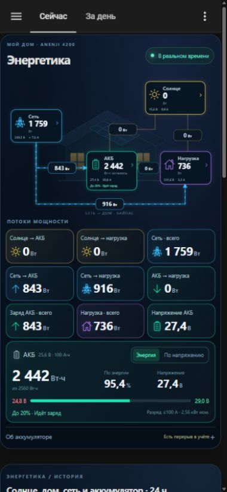
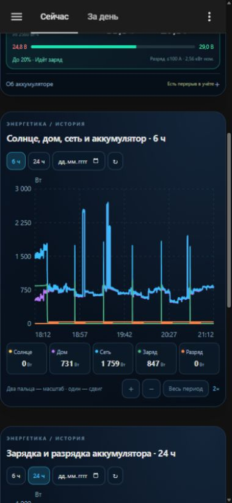
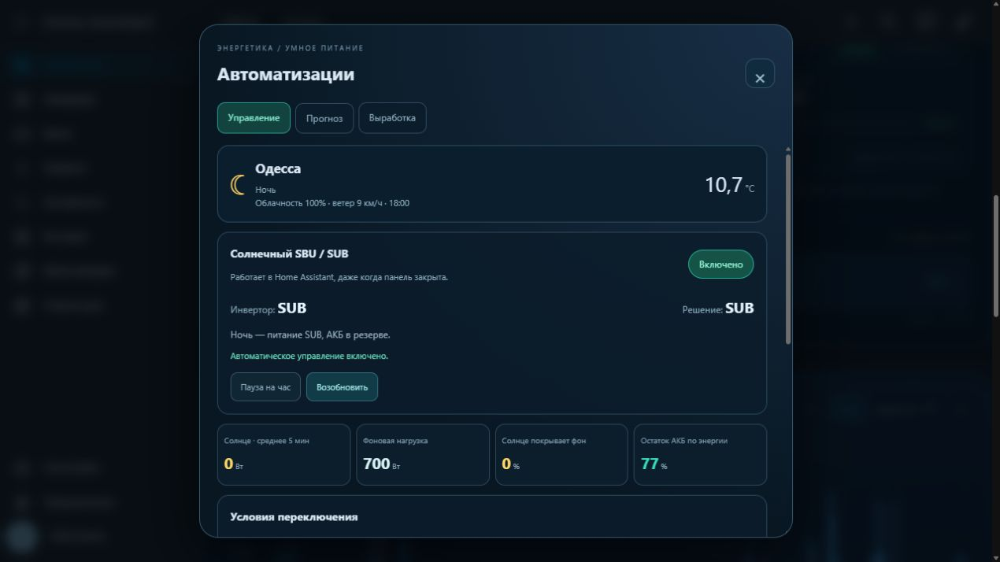
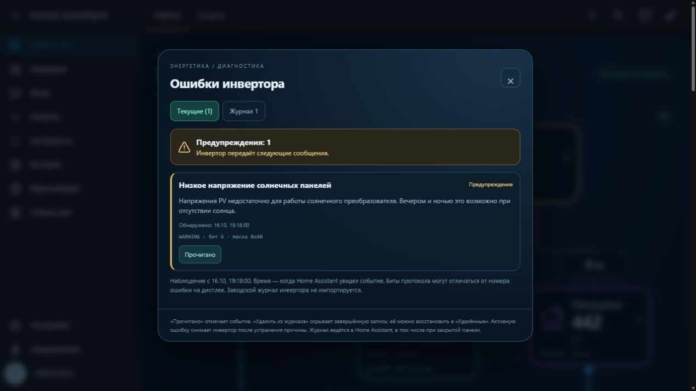
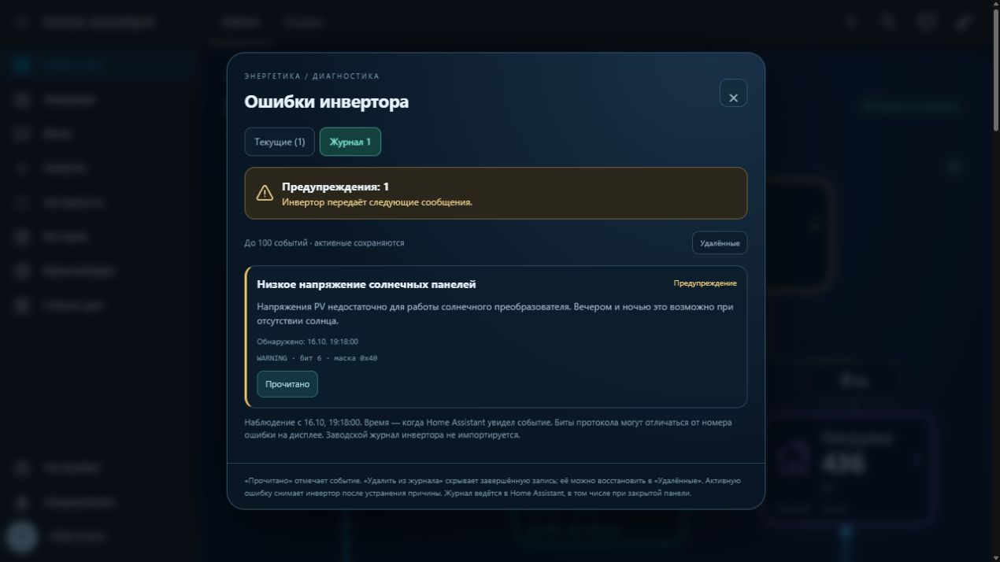
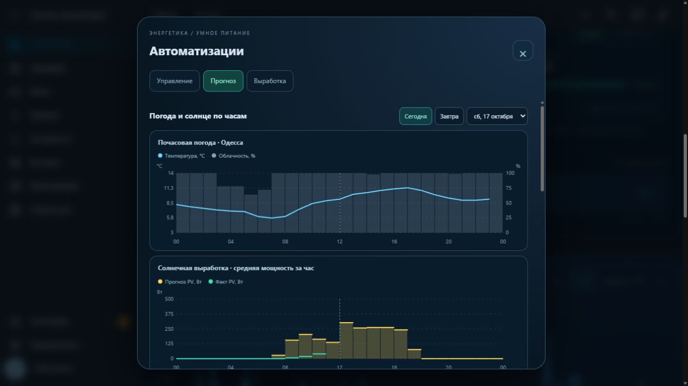
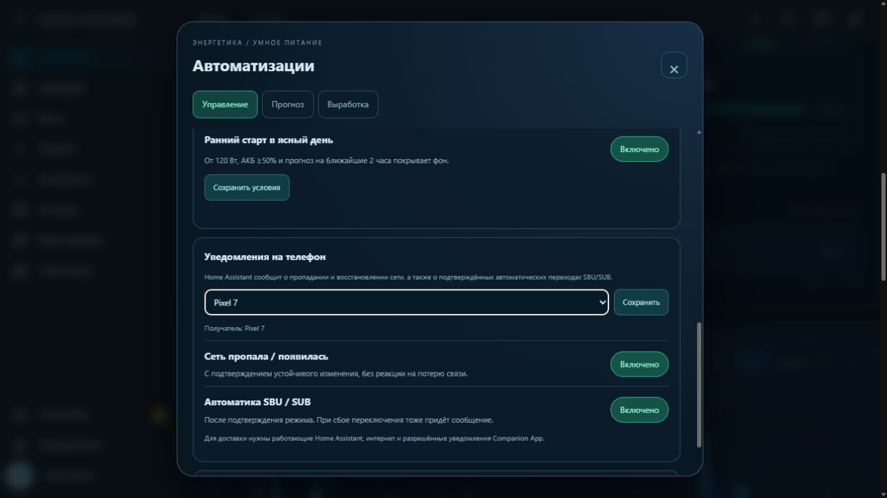

# Енергетика · ANENJI / Home Assistant

Локальна панель для інвертора ANENJI: анімовані потоки, графіки потужності, облік АКБ у Вт·год та прогноз роботи до резерву 20%.




[Меню режимів UTI / SOL / SBU / SUB / SUF](docs/screenshots/mode-menu.jpg)

[Блокування частоти](docs/screenshots/frequency-locked.jpg) · [Перевірка порогів АКБ](docs/screenshots/voltage-constraint.jpg) · [Шестерня на схемі](docs/screenshots/settings-entry.jpg) · [Налаштування інвертора російською](docs/screenshots/settings.jpg) · [Довідка про режими](docs/screenshots/settings-info.jpg)



[Прогноз на 7 днів](docs/screenshots/solar-forecast.jpg) · [Сонячна генерація за минулі дні](docs/screenshots/solar-history.jpg)

[Автоматичне калібрування АКБ до 2560 Вт·год](docs/screenshots/battery-calibration.jpg)

[АКБ: режим енергії](docs/screenshots/battery-energy-mode.jpg) · [АКБ: режим напруги](docs/screenshots/battery-voltage-mode.jpg) — версія 2.8.1: однакове розташування основного значення та відсотка, шкала відповідає вибраному режиму.

Початкові умови: SBU після 5 хвилин відповідної погоди та PV ≥600 Вт або покриття ≥85% фону; SUB уночі, при резерві АКБ 25% або після 10 хвилин слабкої генерації/похмурої погоди. Ранній старт у ясний день доступний окремо. На новій установці керування вимкнене, потім вибір власника відновлюється HA. Докладний алгоритм, пауза та налаштування — у [інструкції](docs/INSTALL.uk.md#погода-прогноз-і-автоматичні-режими).

## Можливості

- Розділ **«Автоматизации»** після плиток: автоматичний SBU/SUB за погодою Одеси, середньою PV, фоновим навантаженням та резервом АКБ. Працює на сервері HA. Ручна зміна режиму в панелі ставить автоматику на паузу на годину.
- Прогноз сонячної генерації на 7 днів для **4 × 630 Вт = 2,52 кВт**, горизонтально 0°, та попередні 7 днів фактичного розрахункового обліку PV. Погода [Open-Meteo](https://open-meteo.com/), оцінка генерації з поправкою на втрати.
- Два однаково побудовані режими АКБ: **енергія** (Вт·год і шкала 0–2560) та **напруга** (В і шкала від нижнього порога до 29,0 В). Відсоток завжди праворуч, основне значення завжди ліворуч; у режимі напруги значень Вт·год немає.
- Частота виходу — тільки для перегляду; зміна заборонена і на сервері. Пов’язані пороги АКБ та струми перевіряються до запису. Неповне підтвердження запису перевіряється читанням регістра без повторної команди.

- Шестерня відкриває доступні налаштування інвертора: зрозумілі російські назви або вихідні назви, пошук, розділи та i з поясненнями параметрів і режимів. Кожний запис підтверджується окремо; значення чекає відповіді інвертора.
- Меню режимів **UTI, SOL, SBU, SUB, SUF** над вузлом мережі: вибір, підтвердження та очікування відповіді інвертора. Потрібне окремо ввімкнене керування EyeBond Local.
- П'ять напрямків: сонце → АКБ, сонце → будинок, мережа → АКБ, мережа → будинок через байпас, АКБ → будинок.
- Потужність, напруга та струм кожного вузла. Струм мережі позначений **≈**: це оцінка активної складової `P/U`, а не виміряний RMS-струм із коефіцієнтом потужності.
- Компактний головний екран: дев'ять плиток у три стовпці на телефоні та окремий блок АКБ. Пояснення й калібрування — у розділі «Об аккумуляторе».
- Залишок АКБ у Вт·год за замовчуванням. Перемикач «По напряжению» вмикає окрему оцінку відсотка за напругою; вибір зберігається на цьому пристрої.
- Таймер до **20%** за поточним чистим розрядом АКБ. Під час заряду або відсутності розряду відображається відповідний стан.
- Графіки в одному стилі з панеллю: 6/12/24 години, вибір дня, підказки, приховування ліній та перехід до історії сутності. На телефоні область графіка має висоту 280 px, п'ять показників легенди розміщені в одному рядку.
- Масштаб двома пальцями, переміщення збільшеної ділянки одним пальцем, кнопки «+», «−» та «Весь период». На комп'ютері: Ctrl/⌘ + колесо, клавіші +/−, стрілки та Home. Мінімальний інтервал — одна хвилина.
- Перевірка телеметрії до обчислення потоків та енергії. Старі помилкові точки на графіках показуються як розриви.
- Плашка діагностики біля схеми: червона для помилок, жовта для попереджень. Російські пояснення, поточні повідомлення та серверний журнал з відміткою прочитання й відновлюваним видаленням записів.
- Локальні JS-модулі без CDN і зовнішніх бібліотек. Історія читається з вашого Home Assistant Recorder.

## Походження та подяки

Базова інтеграція і протокольна робота належать **[groove-max / EyeBond Local](https://github.com/groove-max/ha-eybond-local)**. Вона читає інвертор через локальний EyeBond / SmartESS колектор. Дякуємо автору за відкриті драйвери, протокольні описи й підтримку спільноти.

Споріднена оригінальна панель автора — **[EyeBond Local Card](https://github.com/groove-max/ha-eybond-local-card)**. Цей проєкт розвиває ідею локального енергомоніторингу з потоками та історією. Власні SVG, стилі, графіки та облік АКБ створено окремо за ескізом користувача; код оригінальної картки не копіювався. Це самостійне доповнення, а не офіційний реліз EyeBond Local.

Ліцензія — [MPL-2.0](LICENSE). Походження коду описане в [NOTICE.md](NOTICE.md).

## Перевірене обладнання

Home Assistant 2026.10, EyeBond Local **0.1.53**, драйвер `modbus_smg`, профіль `anenji_4200_protocol_1`. Пристрій із шильдиком ANENJI ANJ-4000W-24V-WIFI: rated power 4200 W, PV 4500 W, максимальна PV-напруга 500 V. Профіль визначається реальною телеметрією, а не лише комерційною назвою корпусу.

АКБ: **25,6 В × 100 А·год = 2560 Вт·год**, резерв 20% = **512 Вт·год**. Це номінальна енергія; реальна корисна енергія залежить від батареї, температури, навантаження та втрат.

Власник підтвердив максимальний безперервний розряд **100 А**. При номінальних 25,6 В це **2,56 кВт на стороні АКБ**; на виході AC потужність нижча через втрати. Ємність 100 А·год та межа струму 100 А — різні характеристики.

Патч драйвера призначений лише для перевіреної версії та моделі. Встановлювач перевіряє SHA-256 початкових файлів і відмовляється змінювати іншу версію. Для іншого інвертора потрібна адаптація меж і сутностей.

## Встановлення за допомогою Codex

1. Налаштуйте [EyeBond Local за українською інструкцією автора](https://github.com/groove-max/ha-eybond-local/blob/main/README.uk.md). Переконайтеся, що живі показання надходять.
2. Завантажте цей репозиторій або клонуйте його. Відкрийте папку як проєкт у Codex. Початкові дії описані в [офіційній документації OpenAI](https://learn.chatgpt.com/docs/quickstart).
3. Відкрийте Home Assistant у доступному для Codex браузері та самостійно увійдіть. Для зміни файлів потрібен File editor або вже налаштований доступ до каталогу конфігурації.
4. Передайте Codex наведений нижче запит, замінивши дані власними. Не публікуйте паролі, токени, серійні номери, `secrets.yaml`, `.storage`, базу історії або діагностичні архіви.

```text
Інтегруй цей репозиторій у мій Home Assistant за README.md та docs/INSTALL.uk.md.
Адреса Home Assistant: <моя локальна адреса>.
Інвертор: <модель>, потужність <Вт>; АКБ: <напруга> В, <ємність> А·год.
Знайди фактичні entity_id в інтеграції, не вигадуй їх.
Збережи резервні копії панелі та файлів перед змінами.
Адаптуй energetika.yaml, карту сутностей картки і межі графіків до мого обладнання.
Залиш облік АКБ за потужністю × часом, із відновленням після перезапуску.
Скидай витрату лише після підтвердженого повного заряду.
Установи локальні JS-модулі, підключи пакет YAML і створи панель «Енергетика».
Патч драйвера застосовуй лише при точному збігу версії та SHA-256.
Перевір конфігурацію, застосуй зміни й перевір показання, історію та мобільний вигляд.
Не змінюй режими роботи, зарядні параметри, хмарний сервер або керування інвертором.
```

Доступність браузерних і файлових інструментів залежить від середовища Codex. Якщо доступу немає, Codex може підготувати адаптовані файли, а ви перенесете їх за ручною інструкцією.

## Ручне встановлення

Повні кроки, відповідність сутностей, оновлення і відкат — у **[docs/INSTALL.uk.md](docs/INSTALL.uk.md)**.

Скопіюйте `custom_components/energetika_dtek` до `custom_components` HA, `energetika.yaml` до каталогу конфігурації HA, сім JS-файлів (`energetika-card.js`, `energetika-history.js`, `energetika-settings.js`, `energetika-automation.js`, `energetika-alerts.js`, `energetika-hourly.js`, `energetika-dtek.js`) — до `www`. Додайте пакет у `homeassistant.packages`, перевірте конфігурацію та перезапустіть HA. Додайте ресурс `/local/energetika-card.js?v=2.8.1` типу JavaScript module і вставте `dashboard-energetika.yaml` у текстовий редактор окремої панелі. Не замінюйте власний `configuration.yaml` цілком.

Для сумісного драйвера використайте `patches/install_guard.py`. Самостійний офлайн-інсталятор цієї конкретної конфігурації збирається командою `python build_deploy.py` у `.deploy/install_energetika_v2.py`. Перед застосуванням на іншому обладнанні адаптуйте всі сутності, ємність і межі.

## Як виправлено піки після вимкнення

У початковому драйвері регістр потужності навантаження 213 читається як unsigned 16 bit. Під час вимкнення/запуску спостерігалися значення близько **65 кВт**, несумісні з цим інвертором. Це відповідає некоректному або службовому вмісту регістра. Без сирого дампу конкретного моменту точне значення та статус не встановлені.

Патч перевіряє фізичні межі потужності, напруги, струму та частоти **до** формування похідних потоків. При неправильному пакеті живі датчики стають недоступними. Наступне коректне опитування автоматично поновлює роботу. Попередня потужність не видається за свіжу і не інтегрується в енергію.

Також виправлено повторне розпізнавання після перезапуску: на цьому пристрої спостерігається значення пріоритету виходу **3**, якого немає в таблиці 0.1.53. Воно більше не блокує моніторинг при підтверджених якорях моделі (`device_type=0x3501`, protocol 1, rated power 4200 W). Окремий патч метаданих `install_modes.py` тепер декодує код 3 як **SUB**: це підтверджено актуальною схемою автора та екраном цього інвертора. Невідомі значення інших моделей не приймаються.

Межа навантаження **8400 Вт** залишає запас для короткої перевантажувальної події. Це межа відбракування телеметрії, а не зміна робочого ліміту чи електричний захист. Звичайні різкі зміни навантаження не згладжуються.

Старі помилкові записи Recorder збережено. Нові графіки показують розриви; повідомлення про кількість відкинутих точок прибрано з інтерфейсу. Заміна на нулі викривила б картину, тому її немає. Накопичені раніше похибки сторонніх добових лічильників заднім числом не переписуються.

Після оновлення EyeBond Local локальний патч може бути замінений: сумісність потрібно перевірити заново. Додаткові межі в картці та графіках продовжують блокувати нереальні значення у власній панелі; серверний облік АКБ також перевіряє діапазон потужності.

## Облік АКБ і прогноз

Залишок = попередній залишок + потужність АКБ × час. Додатна потужність означає заряд, від'ємна — розряд. За годину при 500 Вт із 2560 Вт·год залишиться приблизно **2060 Вт·год**. При такому ж розряді до резерву 512 Вт·год буде близько **3 год 05 хв**.

Автокалібрування: підключена АКБ досягла Bulk мінус 0,2 В протягом хвилини; чистий струм за модулем ≤2 А та чиста потужність за модулем ≤60 Вт тримаються 5 хвилин. Перехід на Float також враховується, якщо верхня напруга спостерігалася в цьому ж циклі не більше 2 годин тому. Пам’ять циклу скидається після стійкого розряду нижче −60 Вт протягом хвилини, втрати свіжої телеметрії більш ніж на 120 секунд, від’єднання АКБ або зміни Bulk/Float. Коротке перезавантаження зберігає чинний цикл, якщо дані поновилися в межах цього часу. Сам лише малий струм при Float не означає повний заряд. Напруга використовується лише для визначення цієї події; між калібруваннями залишок обчислюється за енергією. Окремого сигналу BMS немає, тому повний заряд визначається оцінково.

Повний заряд встановлює залишок у 2560 Вт·год і обнуляє витрату. Ручна кнопка в розділі «Об аккумуляторе» потребує підтвердження. До першого повного заряду залишок не вигадується.

У 2.5.1 виправлено пропуск калібрування на завершенні заряду: показання **−1,4 А / −39 Вт** після верхньої напруги раніше скидали цикл через поріг розряду −30 Вт і не проходили нижню межу −5 Вт. Тепер малий струм перевіряється за модулем (≤2 А), потужність — за модулем (≤60 Вт), а скасування циклу — при розряді нижче −60 Вт протягом хвилини. Це допуск визначення повного заряду. Під час подальшого обліку вся передана інвертором потужність, включно з −39 Вт, інтегрується як раніше. Показані 100% інвертора самі по собі не запускають калібрування. У «Об аккумуляторе» показаний поточний стан очікування автокалібрування.

Режим за напругою використовує формулу `clamp((V − Vmin) / (29 − Vmin) × 100, 0, 100)`. Нижня межа читається з `battery_under_voltage_off_grid` (у цій установці **24,8 В**, червоним), верхня — **29,0 В** (зеленим). У режимі «Энергия» основне значення — залишок Вт·год, шкала — `Wh / 2560` з межами 0 і 2560 Вт·год. У режимі «По напряжению» на тому самому місці показані поточні вольти, а шкала й відсоток обчислюються за напругою. Ліва межа — нижній поріг (червоним), права — 29,0 В (зеленим). Відсоток лишається на тому самому місці в обох режимах. Таймер до 20% показаний лише в режимі енергії; у режимі напруги замість нього є примітка про залежність від навантаження. Це лінійна оцінка, чутлива до навантаження; вона не є характеристикою BMS або точною кривою заряду. Перемикач не змінює облік Вт·год, таймер, калібрування чи параметри інвертора. Штатна оцінка інвертора доступна в розкривному розділі.

Після перезапуску або перерви понад 120 секунд пропущена енергія не екстраполюється. Панель повідомляє про можливу похибку до наступного повного заряду. Таймер оцінюється за **поточним чистим розрядом АКБ**, тому невеликий розряд при живленні від мережі може давати довгий прогноз. Це не оцінка повного автономного живлення всього будинку від батареї.

## Перевірки

```sh
node --test tests/history.test.js
python -m unittest discover -s tests -p test_guard.py
python verify_energy.py
```

Python-перевірка YAML потребує PyYAML та Jinja2 (`python -m pip install PyYAML Jinja2`). JS-картки не потребують npm-залежностей. Сценарії охоплюють 65 535 Вт при вимкненні, розрив історії, справжні ступінчасті навантаження, невідомі значення, експорт у мережу та розрахунок резерву.

## Перемикання пріоритету живлення

Натисніть «Режим» під заголовком «Энергетика», оберіть варіант і натисніть «Применить». Поточний режим має позначку ✓. Картка використовує штатний `select.select_option` та показує успіх після підтвердження інвертора. При помилці чи тайм-ауті успіх не імітується й автоматичного повтору команди немає.

**UTI** — мережа в пріоритеті; **SOL** — сонце в пріоритеті; **SBU** — сонце → АКБ → мережа; **SUB** — сонце → мережа → АКБ. **SUF** допускає віддачу надлишку сонячної енергії в мережу; картка зазначає це перед застосуванням.

Для 0.1.53 скрипт [patches/install_modes.py](patches/install_modes.py) перевіряє SHA-256 та змінює лише метадані `anenji_4200_protocol_1`. Коди 0–3 узяті з [актуальної схеми EyeBond](https://github.com/groove-max/ha-eybond-local/blob/main/custom_components/eybond_local/protocol_catalogs/register_schemas/modbus_smg/base.json). SUF = 4 підтверджений меню власника та профілем SmartESS 0925 у коді автора; режим описаний в [інструкції ANENJI, пункт 01](https://cdn-files.myshopline.com/file/store/1675916196960/ANJ-4-2KW-24V-WIFI.pdf). Фізичне перемикання всіх режимів цим проєктом не перевірене; статус `tested` можливості не підвищується.

Інсталятор не вмикає керування й не змінює режим інвертора. У режимі «Тільки читання» меню блокує команди й показує причину. Для цієї моделі у 0.1.53 потрібен «Повний контроль» у параметрах інтеграції: це загальне налаштування, що відкриває також інші команди EyeBond, тому потрібна свідома згода власника. Сама картка надсилає лише вибраний пріоритет живлення. Деталі встановлення та відкату — у docs/INSTALL.uk.md.

## Помилки та журнал · 2.6.1





Плашка зверху відкриває «Текущие» та «Журнал». Дані беруться з рідних `fault_code` / `warning_code` EyeBond Local: це 32-бітові маски SMG, а не номер помилки LCD. Переклади відповідають таблицям EyeBond Local 0.1.53; невідомі та зарезервовані біти показуються без вигаданої розшифровки. Помилки червоні, попередження жовті. Наприклад, `warning_code = 64` означає біт 6 — низька напруга PV, що можливе ввечері та вночі.

`sensor.energetika_inverter_alerts` зберігає до 100 останніх епізодів з пріоритетним збереженням усіх активних. Журнал працює на сервері при закритому браузері та відновлюється після перезапуску HA. Один тривалий сигнал створює один епізод; повторне виникнення після завершення — новий. Недоступні або старші 120 секунд дані не закривають подію. Час — момент спостереження Home Assistant; події під час повного вимкнення HA або між опитуваннями не відновлюються, заводський журнал інвертора не імпортується.

«Прочитано» змінює лише відмітку журналу. «Удалить из журнала» доступне для завершених подій і приховує запис; вкладка «Удалённые» дозволяє відновити його, доки він входить до збережених 100 подій. Активну помилку прибрати цією кнопкою неможливо: вона зникає з поточних лише після скидання біта самим інвертором. Жодна дія журналу не надсилає команд скидання або зміни параметрів інвертора.

## Сповіщення та погодинні графіки · 2.7.1





У «Автоматизации → Управление» оберіть телефон Companion App та збережіть його. Окремі перемикачі вмикають повідомлення про зникнення/повернення мережі й автоматичні переходи SBU/SUB. Мета зберігається локально у `input_text.energetika_notification_target`; жоден приватний телефон не зашитий у репозиторій. Використовується [notify.send_message](https://www.home-assistant.io/integrations/notify/) для сутності `notify` мобільного застосунку.

Наявність мережі визначається за свіжою вхідною напругою: ≤50 В — відсутня, ≥90 В — присутня; між порогами зберігається попередній стан. Затримки 5 + 10 секунд відсікають короткі зміни. Перше достовірне спостереження записується мовчки; останній підтверджений стан відновлюється після перезапуску. Недоступний інвертор не означає зникнення електрики. Після повернення зв’язку повідомляється лише зміна від останнього підтвердженого стану; час події — момент спостереження HA. Для доставлення потрібні живлення HA/мережевого обладнання, інтернет та дозволені сповіщення Companion App.

SBU/SUB повідомляється тільки з гілки серверної автоматики після підтвердження нового режиму інвертором. Ручні перемикання не генерують ці повідомлення. Якщо команда не підтверджена, повідомляється зупинка автоматики. Помилка доставлення push не повторює команду інвертору й не створює цикл повідомлень.

Основні графіки мають 6, **12** та 24 години — [приклад за 12 годин](docs/screenshots/history-12-hours.jpg). У «Автоматизации → Прогноз» додано два графіки зі спільним часовим маркером і вибором дня: температура/хмарність, нижче прогнозна й фактична середня потужність PV за годину. Натисніть на годину для порівняння. Прогноз PV: горизонтальне випромінювання × 2,52 кВт × поправка на втрати. Радіація Open-Meteo на час `t+1h` відповідає інтервалу `[t,t+1h]`; зсув виправлено при побудові графіка. Фактичні значення читаються зі статистики `pv_power` Recorder; пропуски не підміняються нулями. Поточна година може бути неповною. Часові мітки прив’язані до Europe/Kyiv, з урахуванням днів переходу часу.

## Мережа, відновлення погоди та ДТЕК · 2.8.0

[Відсутність мережі на головній схемі](docs/screenshots/grid-outage.jpg) · [Поточне відключення ДТЕК](docs/screenshots/dtek-status.jpg) · [Запас АКБ і добовий графік](docs/screenshots/dtek-budget.jpg)

За підтвердженої відсутності напруги плитка мережі має червону рамку, перекреслену опору та напис «СЕТИ НЕТ». Недоступна телеметрія не вважається відсутністю електрики. Погода опитується раз на 5 хвилин; за відсутніх або застарілих даних виконується повторна спроба щохвилини. У погодному блоці є ручне оновлення.

Вкладка «Автоматизации → ДТЭК» використовує [сайт ДТЕК Одеські електромережі](https://www.dtek-oem.com.ua/ua/shutdowns). Населений пункт, вулиця і будинок обираються зі списків сайту. Адреса зберігається тільки в локальному сховищі HA; у репозиторії адрес і сесійних cookies немає. Зміна адреси доступна адміністраторам HA. Реєстрація на ДТЕК та перенесення паролів не потрібні: звичайна сесія сайту з CSRF, як у наданому власником Android-проєкті. Захисні перевірки сайту не обходяться; при їх появі показується недоступність даних.

Поточний статус, `start_date`, `end_date`, причини та групи беруться з відповіді адресного запиту. Порожні поля чинного статусу для знайденого будинку означають «за даними сайту світло очікується», а не підтвердження фізичної напруги. Якщо інвертор бачить 0 В, панель показує цю розбіжність. За відсутньої або непідтримуваної відповіді статус не підмінюється на «світло є».

Показаний опублікований добовий графік для груп адреси, якщо ДТЕК його надає. Межі половин години збережені, можливі/невідомі періоди відрізняються від підтверджених відключень. Для будинку з кількома лініями немає довільного вибору однієї групи. Час повернення береться насамперед із `end_date`; добовий графік використовується як окремо позначений резервний орієнтир лише для однозначної групи. За екстрених відключень графік не визначає строк. Минуле або нерозібране значення не переноситься автоматично на завтра.

Для майбутніх автоматизацій створені `sensor.energetika_dtek_restoration`, `sensor.energetika_dtek_next_outage`, `sensor.energetika_dtek_next_restoration` та атрибути `sensor.energetika_dtek_status`. Оцінка АКБ до повернення мережі — `sensor.energetika_outage_energy_required` і `sensor.energetika_outage_energy_margin`: поточний чистий розряд × час до орієнтира, з резервом 512 Вт·год. Це оцінка за незмінного навантаження та PV; перерви в обліку АКБ позначаються. Відсутній чи застарілий строк не дає позитивного висновку про запас. Жодні розетки або навантаження цим доповненням не перемикаються.
