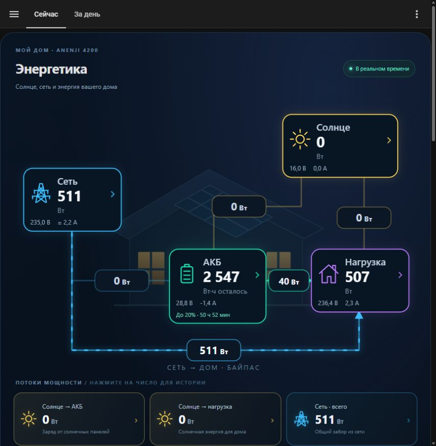
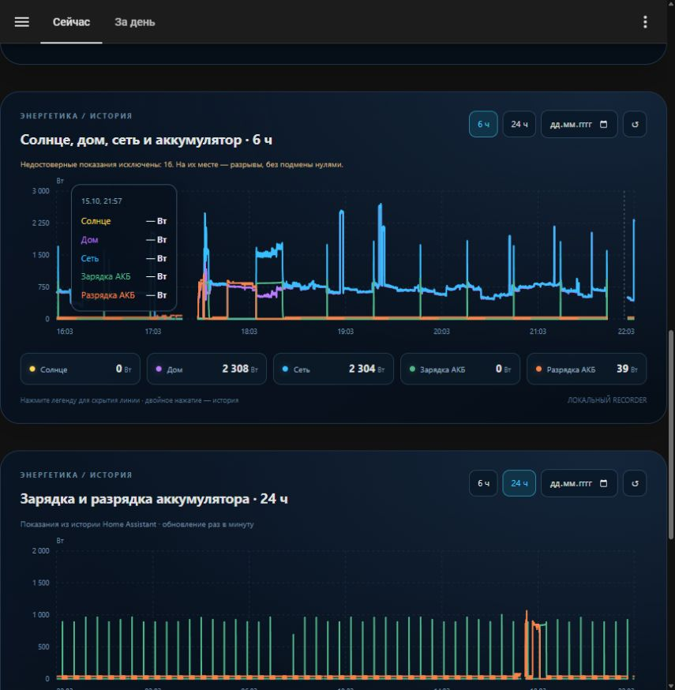

# Енергетика · ANENJI / Home Assistant

Локальна панель для інвертора ANENJI: анімовані потоки, графіки потужності, облік АКБ у Вт·год та прогноз роботи до резерву 20%.




## Можливості

- П'ять напрямків: сонце → АКБ, сонце → будинок, мережа → АКБ, мережа → будинок через байпас, АКБ → будинок.
- Потужність, напруга та струм кожного вузла. Струм мережі позначений **≈**: це оцінка активної складової `P/U`, а не виміряний RMS-струм із коефіцієнтом потужності.
- Залишок АКБ у Вт·год, окремо — відсоток за витраченою енергією, напруга і штатний відсоток інвертора.
- Таймер до **20%** за поточним чистим розрядом АКБ. Під час заряду або відсутності розряду відображається відповідний стан.
- Графіки в одному стилі з панеллю: 6/24 години, вибір дня, підказки, приховування ліній та перехід до історії сутності.
- Перевірка телеметрії до обчислення потоків та енергії. Старі помилкові точки на графіках показуються як розриви.
- Локальні JS-модулі без CDN і зовнішніх бібліотек. Історія читається з вашого Home Assistant Recorder.

## Походження та подяки

Базова інтеграція і протокольна робота належать **[groove-max / EyeBond Local](https://github.com/groove-max/ha-eybond-local)**. Вона читає інвертор через локальний EyeBond / SmartESS колектор. Дякуємо автору за відкриті драйвери, протокольні описи й підтримку спільноти.

Споріднена оригінальна панель автора — **[EyeBond Local Card](https://github.com/groove-max/ha-eybond-local-card)**. Цей проєкт розвиває ідею локального енергомоніторингу з потоками та історією. Власні SVG, стилі, графіки та облік АКБ створено окремо за ескізом користувача; код оригінальної картки не копіювався. Це самостійне доповнення, а не офіційний реліз EyeBond Local.

Ліцензія — [MPL-2.0](LICENSE). Походження коду описане в [NOTICE.md](NOTICE.md).

## Перевірене обладнання

Home Assistant 2026.10, EyeBond Local **0.1.53**, драйвер `modbus_smg`, профіль `anenji_4200_protocol_1`. Пристрій із шильдиком ANENJI ANJ-4000W-24V-WIFI: rated power 4200 W, PV 4500 W, максимальна PV-напруга 500 V. Профіль визначається реальною телеметрією, а не лише комерційною назвою корпусу.

АКБ: **25,6 В × 100 А·год = 2560 Вт·год**, резерв 20% = **512 Вт·год**. Це номінальна енергія; реальна корисна енергія залежить від батареї, температури, навантаження та втрат.

Патч драйвера призначений лише для перевіреної версії та моделі. Встановлювач перевіряє SHA-256 початкових файлів і відмовляється змінювати іншу версію. Для іншого інвертора потрібна адаптація меж і сутностей.

## Встановлення за допомогою Codex

1. Налаштуйте [EyeBond Local за українською інструкцією автора](https://github.com/groove-max/ha-eybond-local/blob/main/README.uk.md). Переконайтеся, що живі показання надходять.
2. Завантажте цей репозиторій або клонуйте його. Відкрийте папку як проєкт у Codex. Початкові дії описані в [офіційній документації OpenAI](https://learn.chatgpt.com/docs/quickstart).
3. Відкрийте Home Assistant у доступному для Codex браузері та самостійно увійдіть. Для зміни файлів потрібен File editor або вже налаштований доступ до каталогу конфігурації.
4. Передайте Codex наведений нижче запит, замінивши дані власними. Не публікуйте паролі, токени, серійні номери, `secrets.yaml`, `.storage`, базу історії або діагностичні архіви.

```text
Інтегруй цей репозиторій у мій Home Assistant за README.md та docs/INSTALL.uk.md.
Адреса Home Assistant: <моя локальна адреса>.
Інвертор: <модель>, потужність <Вт>; АКБ: <напруга> В, <ємність> А·год.
Знайди фактичні entity_id в інтеграції, не вигадуй їх.
Збережи резервні копії панелі та файлів перед змінами.
Адаптуй energetika.yaml, карту сутностей картки і межі графіків до мого обладнання.
Залиш облік АКБ за потужністю × часом, із відновленням після перезапуску.
Скидай витрату лише після підтвердженого повного заряду.
Установи локальні JS-модулі, підключи пакет YAML і створи панель «Енергетика».
Патч драйвера застосовуй лише при точному збігу версії та SHA-256.
Перевір конфігурацію, застосуй зміни й перевір показання, історію та мобільний вигляд.
Не змінюй режими роботи, зарядні параметри, хмарний сервер або керування інвертором.
```

Доступність браузерних і файлових інструментів залежить від середовища Codex. Якщо доступу немає, Codex може підготувати адаптовані файли, а ви перенесете їх за ручною інструкцією.

## Ручне встановлення

Повні кроки, відповідність сутностей, оновлення і відкат — у **[docs/INSTALL.uk.md](docs/INSTALL.uk.md)**.

Скопіюйте `energetika.yaml` до каталогу конфігурації HA, обидва JS-файли — до `www`, додайте пакет у `homeassistant.packages`, додайте ресурс `/local/energetika-card.js?v=2.1` типу JavaScript module і вставте `dashboard-energetika.yaml` у текстовий редактор окремої панелі. Не замінюйте власний `configuration.yaml` цілком.

Для сумісного драйвера використайте `patches/install_guard.py`. Самостійний офлайн-інсталятор цієї конкретної конфігурації збирається командою `python build_deploy.py` у `.deploy/install_energetika_v2.py`. Перед застосуванням на іншому обладнанні адаптуйте всі сутності, ємність і межі.

## Як виправлено піки після вимкнення

У початковому драйвері регістр потужності навантаження 213 читається як unsigned 16 bit. Під час вимкнення/запуску спостерігалися значення близько **65 кВт**, несумісні з цим інвертором. Це відповідає некоректному або службовому вмісту регістра. Без сирого дампу конкретного моменту точне значення та статус не встановлені.

Патч перевіряє фізичні межі потужності, напруги, струму та частоти **до** формування похідних потоків. При неправильному пакеті живі датчики стають недоступними. Наступне коректне опитування автоматично поновлює роботу. Попередня потужність не видається за свіжу і не інтегрується в енергію.

Також виправлено повторне розпізнавання після перезапуску: на цьому пристрої спостерігається значення пріоритету виходу **3**, якого немає в таблиці 0.1.53. Воно більше не блокує моніторинг при підтверджених якорях моделі (`device_type=0x3501`, protocol 1, rated power 4200 W). Назва лишається `Unknown (3)`: сенс режиму не вигадується і нова опція запису не додається. Невідомі значення інших моделей не приймаються.

Межа навантаження **8400 Вт** залишає запас для короткої перевантажувальної події. Це межа відбракування телеметрії, а не зміна робочого ліміту чи електричний захист. Звичайні різкі зміни навантаження не згладжуються.

Старі помилкові записи Recorder збережено. Нові графіки показують розриви і кількість відкинутих точок. Заміна на нулі викривила б картину, тому її немає. Накопичені раніше похибки сторонніх добових лічильників заднім числом не переписуються.

Після оновлення EyeBond Local локальний патч може бути замінений: сумісність потрібно перевірити заново. Додаткові межі в картці та графіках продовжують блокувати нереальні значення у власній панелі; серверний облік АКБ також перевіряє діапазон потужності.

## Облік АКБ і прогноз

Залишок = попередній залишок + потужність АКБ × час. Додатна потужність означає заряд, від'ємна — розряд. За годину при 500 Вт із 2560 Вт·год залишиться приблизно **2060 Вт·год**. При такому ж розряді до резерву 512 Вт·год буде близько **3 год 05 хв**.

Автокалібрування: АКБ підключена, заряд активний, напруга не нижча за налаштування Bulk мінус 0,2 В, струм заряду 0–2 А і модуль потужності АКБ не вище 60 Вт протягом 5 хвилин. Напруга використовується лише для визначення цієї події; між калібруваннями залишок обчислюється за енергією. Окремого сигналу BMS немає, тому повний заряд визначається оцінково.

Повний заряд встановлює залишок у 2560 Вт·год і обнуляє витрату. Ручна кнопка в розділі «Как считается энергия аккумулятора» потребує підтвердження. До першого повного заряду залишок не вигадується.

Після перезапуску або перерви понад 120 секунд пропущена енергія не екстраполюється. Панель повідомляє про можливу похибку до наступного повного заряду. Таймер оцінюється за **поточним чистим розрядом АКБ**, тому невеликий розряд при живленні від мережі може давати довгий прогноз. Це не оцінка повного автономного живлення всього будинку від батареї.

## Перевірки

```sh
node --test tests/history.test.js
python -m unittest discover -s tests -p test_guard.py
python verify_energy.py
```

Python-перевірка YAML потребує PyYAML та Jinja2 (`python -m pip install PyYAML Jinja2`). JS-картки не потребують npm-залежностей. Сценарії охоплюють 65 535 Вт при вимкненні, розрив історії, справжні ступінчасті навантаження, невідомі значення, експорт у мережу та розрахунок резерву.
