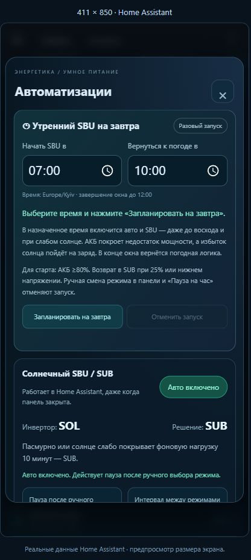

# Встановлення, адаптація та відкат

## Відповідність сутностей

Зразок використовує префікс `sensor.anenji_4200_protocol_1_`:

- `grid_power`, `pv_power`, `load_power` — сумарні потужності;
- `grid_voltage`, `pv_voltage`, `output_voltage`, `battery_voltage` — напруги;
- `pv_current`, `output_current`, `battery_current` — виміряні струми;
- `battery_power` — чиста потужність АКБ, «плюс» = заряд;
- `pv_to_battery_power`, `pv_to_home_power`, `grid_to_battery_power`, `grid_to_home_power`, `battery_to_home_power` — розподіл потоків;
- `battery_current`, `battery_bulk_voltage`, `battery_float_voltage` — визначення завершення заряду;
- `battery_under_voltage_off_grid` — нижня межа для оцінки відсотка за напругою;
- `binary_sensor.anenji_4200_protocol_1_battery_connected` і `binary_sensor.anenji_4200_protocol_1_charging_active` — ознаки стану.

У прикладі існують `sensor.zariadka_akb` та `sensor.razriadka_akb`. Якщо їх немає, створіть шаблонні датчики `max(battery_power, 0)` і `max(-battery_power, 0)` з одиницею W та класами power/measurement. При недоступному джерелі вони також мають бути недоступними. Вкажіть фактичні entity_id у JS і YAML панелі.

Для іншого префікса змініть його в обох YAML-файлах і константі `ROOT` картки. Окремі entity_id картки можна перевизначити через `entities` у її конфігурації; серверні шаблони адаптуються окремо.

## Резервні копії

Експортуйте поточний YAML панелі. Скопіюйте `configuration.yaml`, наявний `energetika.yaml`, JS-модулі та файли інтеграції, які змінюватимете. Збережіть шлях для відкату.

## Пакет та модулі

Скопіюйте `custom_components/energetika_dtek` до однойменного каталогу в `custom_components` HA. Цей компонент потрібен для пакета версії 2.8.0; адреса задається пізніше через панель.

Скопіюйте `energetika.yaml` у корінь каталогу конфігурації. До наявної секції `homeassistant` додайте пакет:

```yaml
homeassistant:
  packages:
    energetika: !include energetika.yaml
```

Не створюйте другу секцію `homeassistant`. Якщо пакети вже підключені каталогом, скористайтеся наявною схемою.

Скопіюйте **десять** файлів `energetika-card.js`, `energetika-history.js`, `energetika-date.js`, `energetika-settings.js`, `energetika-manual.js`, `energetika-automation.js`, `energetika-data.js`, `energetika-alerts.js`, `energetika-hourly.js` та `energetika-dtek.js` до `www`. Створіть у `www` також копію `energetika-card.js` з назвою `energetika-card-2.16.1.js` для головного ресурсу. Головна картка імпортує історію та налаштування відносними шляхами. У Налаштування → Інформаційні панелі → Ресурси додайте `/local/energetika-card-2.16.1.js`, тип **Модуль JavaScript**. Додаткові ресурси для імпортованих модулів не потрібні.

При першому створенні `www` може знадобитися перезапуск. Перевірте конфігурацію через інструменти YAML перед перезапуском.

## Батарея та резерв

Номінал зразка: 2560 Вт·год, 25,6 В, 100 А·год; резерв 512 Вт·год (20%). Для іншої батареї оновіть усі значення в шаблонах, межах картки, підписах і підтвердженні ручного калібрування.

Підпис розряду 100 А підтверджений власником цієї АКБ. Для іншої батареї вкажіть фактичну безперервну межу BMS. 100 А·год не означає автоматично 100 А. Номінальна потужність тут — 25,6 × 100 = 2560 Вт на стороні батареї.

Шаблон `sensor.energetika_battery_percent_voltage` обчислює окремий лінійний відсоток від `battery_under_voltage_off_grid` до **29,0 В**. Ключ `percent_voltage` задає сутність для відкриття історії відсотка. Поточні відсоток і шкала картки обчислюються разом із `voltage` та `voltage_min`, щоб вони відповідали показаній напрузі. При іншому верхньому порозі змініть формулу YAML, константу `high` у JS та підписи. Це оцінка за напругою під навантаженням; лічильник Вт·год продовжує працювати незалежно. Режим за замовчуванням — «Энергия», перемикач зберігається локально в браузері. В обох режимах основне значення зліва, відсоток справа. Режим енергії показує залишок Вт·год і шкалу 0–2560 Вт·год; режим напруги — поточні вольти та шкалу `(V − Vmin) / (29 − Vmin)` з червоною нижньою й зеленою верхньою межами у вольтах. Вт·год та таймер до резерву в режимі напруги приховані. Таймер використовує облік енергії й відображається лише в енергетичному режимі.

Верхня напруга береться з `battery_bulk_voltage`; код не змінює параметри інвертора. Допуск 0,2 В, малий струм 2 А, потужність 60 Вт і затримка 5 хвилин повинні відповідати вашій батареї та алгоритму заряду. Універсального порогу для всіх хімій немає.

Після верхньої напруги зберігається ознака поточного циклу до 2 годин. При підтримувальному заряді допускається малий струм **обох знаків**: `abs(I) ≤2 А`, `abs(P) ≤60 Вт` протягом 5 хвилин. Показання −1,4 А / −39 Вт самі по собі не скидають цикл. Його скидають стійкий розряд нижче −60 Вт протягом хвилини, від’єднання АКБ, зниження напруги нижче Float −0,3 В, зміна Bulk/Float або відсутність свіжих даних більш ніж 120 секунд. Старий цикл після тривалого вимкнення не поновлюється лише тому, що напруга знову піднялася. Короткий перезапуск зберігає цикл за наявності недавніх достовірних даних.

Стан очікування показаний у «Об аккумуляторе» та `sensor.energetika_battery_calibration_status`. Якщо ви підтвердили вже повний заряд, ручна кнопка встановлює **2560 Вт·год**, записує джерело `manual` і час повного заряду та знімає ознаку перерви. Автоматична подія записує `charge_completion`. Подальший залишок обчислюється за переданою потужністю, включно з малою від’ємною: наприклад, −39 Вт за годину зменшує залишок на 39 Вт·год. Сигнал інвертора «100%» показаний окремо й не підміняє цей облік.

## Панель

### Погода, прогноз і автоматичні режими

Розділ «Автоматизации» розміщений після всіх плиток, перед графіками. Вкладки: керування, прогноз, минула генерація. Всі таймери та команди виконуються сервером Home Assistant, браузер можна закрити.

Новий пакет встановлює автоматику **вимкненою**. Після перезапуску один раз заповнюються початкові пороги. Подальші зміни з панелі зберігаються між перезапусками. Щоб почати керування, відкрийте розділ і ввімкніть «Солнечный SBU / SUB». Потрібний уже дозволений режим EyeBond Local `full` та обидва нативні варіанти SBU/SUB у select. Установка пакета сама не відкриває доступ до керування.

Початкова логіка:

- PV — середнє за 5 хвилин. Фон будинку — 25-й процентиль за 30 хвилин, обмежений 400–700 Вт, тому короткий пік чайника не піднімає фон.
- SBU: день, свіжа погода, ясно/переважно ясно/мінлива хмарність (WMO 0/1/2, хмарність ≤85%), свіжа телеметрія, АКБ ≥35% за енергією. Сонце ≥600 Вт **або** ≥50% фону та щонайменше 150 Вт. Стабільність 5 хвилин.
- Ранній старт (окремий перемикач): ясно, хмарність ≤30%, PV ≥120 Вт, АКБ ≥50%, прогноз середньої потужності на наступні 2 години не менший за фон.
- SUB: ніч, АКБ ≤25% або напруга ≤порогу автономної роботи +0,2 В. Ці умови мають пріоритет. Похмура погода, слабка генерація чи втрата даних — після 10 хвилин. Поріг слабкого покриття на 15 п.п. нижчий за обраний вхід (50% → 35%); поріг слабкої потужності — відповідна частка фону, максимум 200 Вт. Слабкість за потужністю/покриттям враховується, коли умови входу SBU не виконані.
- Мінімум 10 хвилин між звичайними перемиканнями; ніч і резерв можуть перервати цю затримку. Справжній стан інвертора перевіряється після однієї команди. Якщо немає підтвердження, подальші автоматичні записи зупиняються до «Возобновить».

Ручний вибір режиму в меню цієї панелі або її налаштуваннях ставить автоматику на паузу на годину **перед** командою. Зміни з LCD, іншої картки або іншої автоматизації не вважаються паузою автоматично: спочатку вимкніть керування тут. «Пауза на час», «Возобновить» та головний перемикач доступні в розділі.

Автоматика змінює **лише пріоритет виходу SBU/SUB**. Вона не змінює стратегію заряду, напруги, струми чи частоту. Коли вимикаєте автоматику, поточний режим інвертора зберігається. Фізичний захист інвертора/BMS залишається необхідним.

Погода: REST-запит до [Open-Meteo Forecast API](https://open-meteo.com/en/docs) кожні 15 хвилин, публічний центр Одеси (46.4825, 30.7233), без ключів та приватних координат. Дані старші за 45 хвилин не дозволяють новий SBU. У запиті використано `Europe/Kyiv`, Unix timestamps, поточну хмарність, WMO-код, температуру, вітер, погодинне випромінювання та добову суму.

Панелі цієї установки: **4 × 630 Вт, 2,52 кВт**, горизонтально **0°**. Для горизонтальної поверхні азимут не впливає на геометрію. Прогноз за день: `shortwave_radiation_sum (МДж/м²) / 3,6 × 2,52 × (1 − втрати/100)`, результат у кВт·год. Початкова поправка втрат 20%, редагується в панелі. Це модельна оцінка без вимірювання затінення, снігу та забруднення, не гарантія генерації. Для похилої установки потрібне погодинне випромінювання на відповідну площину та інша формула; не залишайте горизонтальний розрахунок.

Минула генерація читається з добової статистики Recorder для `sensor.anenji_4200_protocol_1_estimated_pv_energy_today`, `period: day`, `change`, кВт·год. Це власне PV, не енергія мережі. Сьогодні показується поточний добовий лічильник. Відсутні дні — прочерк, дні з перервами можуть бути неповними. Неправильні старі накопичення не переписуються. Потрібний Recorder та нативний датчик із `state_class: total_increasing`.

Сирий прогноз та список днів виключені з Recorder, щоб не зберігати великі атрибути кожні 15 хвилин. Статистичні датчики PV/фону використовують стандартну [Statistics integration](https://www.home-assistant.io/integrations/statistics/). Перевірте, що ваші власні правила `recorder.include` не блокують сонячний добовий лічильник.

Для іншої установки адаптуйте координати міста, часовий пояс, потужність та кут панелей, діапазон фону, резерв і префікси. Значення 2,52 кВт задано у формулах YAML та підписах JS. Усі сутності пакета мають префікс `energetika_`; головні: `sensor.energetika_solar_strategy`, `input_boolean.energetika_solar_auto`, `input_boolean.energetika_solar_fault`, `input_text.energetika_solar_result`.

Після оновлення перевірте YAML, перезапустіть HA, оновіть ресурс картки до **2.13.1** та перезавантажте браузер. Перевіряйте готовність за реальними даними; не змінюйте режими інвертора, зарядні налаштування або показання датчиків лише для демонстрації.

Створіть окрему панель, відкрийте редагування → текстовий редактор і вставте `dashboard-energetika.yaml`. Збережіть та завершіть редагування. Оновіть сторінку й фронтенд телефонного застосунку, щоб завантажився новий JS.

Кожний графік має власні кнопки 6/12/24 години та календар. Вкладка «За день» починає з поточної дати. Час показаний у часовому поясі браузера; узгодьте його з часовим поясом HA.

Двома пальцями збільшуйте або зменшуйте ділянку; одним пальцем пересувайте збільшений графік. Усередині області графіка жести керують історією, для прокручування сторінки торкніться заголовка або простору між картками. «Весь период» повертає обрані 6/12/24 години чи день; ↻ лише оновлює дані. Кнопки +/− також змінюють масштаб. На комп'ютері доступні Ctrl/⌘ + колесо, стрілки, +/− та Home. Натискання легенди приховує лінію, подвійне — відкриває історію сутності.

Мобільна верстка використовує три стовпці плиток, коротші відступи й висоту схеми залежно від екрана. На екрані 375 × 700 усі основні показники та блок АКБ поміщаються над нижнім краєм; великий системний шрифт або додаткові панелі застосунку можуть потребувати прокручування.

## Патч драйвера

Лише для EyeBond Local 0.1.53 та профілю `anenji_4200_protocol_1`. Розмістіть `patches/install_guard.py` і `patches/telemetry_guard.py` поруч та виконайте:

```sh
python3 install_guard.py --config /homeassistant
```

У вашому контейнері каталог може називатися `/config`; спочатку перевірте наявність `configuration.yaml`. Встановлювач перевірить SHA-256 і синтаксис, створить `energetika-backup-<UTC>` та атомарно замінить лише цільові файли. Потім перезапустіть HA.

При розбіжності версії **не вимикайте перевірку SHA-256**. Попросіть Codex перенести мінімальний патч на фактичну версію з аналізом драйвера та координатора.

Патч також дозволяє моніторинг для стабільного значення `Unknown (3)` пріоритету виходу цього профілю, зберігаючи всі якорі ідентифікації. Окремий патч метаданих тепер декодує цей код як SUB; дозвіл на запис налаштовується незалежно.

Межі валідатора: навантаження до 8400 Вт, PV до 5400 Вт, мережа ±11000 Вт, AC 0–300 В, батарея 0–40 В, PV 0–500 В. Це межі відбракування телеметрії із запасом, а не робочі налаштування чи гарантія допустимого режиму обладнання. Інші профілі патч не змінює.

## Перевірка роботи

- Цифри відповідають інвертору та відкривають відповідну історію.
- На вузлах видно напругу й струм; мережевий струм позначено «≈».
- Залишок АКБ відновлюється після перезапуску; після пропуску є попередження про похибку.
- Калібрування відбувається лише після всіх умов повного заряду.
- При розряді є прогноз до 20%, при заряді — відповідний стан.
- Нереальні 65 кВт показані розривами; справжні зміни навантаження збережені.

Команди регресійних перевірок наведені в README. Фізично вимикати інвертор чи PV для тесту інтерфейсу не потрібно: помилковий пакет відтворюється програмно.

## Оновлення та відкат

При зміні JS збільшуйте `?v=` ресурсу та імпорту історії, потім оновлюйте сторінку. Після оновлення EyeBond Local перевірте сумісність патча — він може бути замінений новою версією інтеграції.

Для відкату відновіть `drivers/smg.py` та `runtime/hub.py` із `energetika-backup-*`, YAML/JS із `energetika-ui-backup-*`, поверніть збережений YAML панелі й перезапустіть HA. `drivers/telemetry_guard.py` можна залишити: без імпорту він не впливає на інтеграцію. Базу Recorder не видаляйте.

## Меню режимів живлення

Для цього ANENJI 4200 підтверджені UTI (у повідомленні власника — UEI), SOL, SBU, SUB та SUF. Регістр 301: 0 = UTI, 1 = SOL, 2 = SBU, 3 = SUB, 4 = SUF. Коди 0–3 узгоджені з актуальною схемою автора; SUF = 4 — з його SmartESS-профілем 0925 та меню цього пристрою. На іншій прошивці перевірте відповідність.

```sh
python3 install_modes.py --config /homeassistant
```

Скрипт перевіряє SHA-256 двох початкових JSON-файлів моделі у 0.1.53, створює `energetika-mode-backup-<UTC>` і змінює тільки цей профіль та схему. Потім перезапустіть HA для очищення кешу метаданих. Скрипт не надсилає команд інвертору та не змінює політику доступу. Офлайн-інсталятор `build_deploy.py` вже включає цей крок.

Сутності картки: `mode_select` = `select.anenji_4200_protocol_1_output_source_priority`, `output_priority` = сенсор поточного пріоритету, `control_mode` = сенсор режиму керування. Для інших entity_id перевизначте ці ключі в `entities` картки.

У режимі «Тільки читання» вибір заблокований. Для ANENJI 4200 у 0.1.53 параметри інтеграції → «Параметри роботи» → «Режим керування» → «Повний контроль» відкривають запис. Це загальне ручне перевизначення політики EyeBond, а не дозвіл лише для одного меню; потрібна свідома згода власника. Якщо `select` вимкнений у реєстрі, увімкніть саме Output Source Priority в налаштуваннях пристрою.

Оберіть режим і натисніть «Применить». Картка очікує підтвердження інвертора; автоматичних повторів команди немає. Для SUF зазначено віддачу надлишку в мережу. Не перемикайте фізичні режими лише задля перевірки вигляду інтерфейсу.

Для відкату режимів відновіть два JSON-файли зі збереженою структурою каталогів із `energetika-mode-backup-*` і перезапустіть HA. Політика керування повертається окремо через параметри інтеграції.


## Налаштування інвертора через шестерню

Праворуч угорі схеми є ⚙. Сонячний вузол зміщений ближче до центру, висота головного екрана збережена. Вікно має пошук і розділи «Питание», «Заряд», «Аккумулятор», «Защита», «Экран и звук», «Система». Назви за замовчуванням російські; «Исходные названия» показує назви драйвера. Вибір мови зберігається локально. Кнопка i пояснює параметр та кожний варіант режиму російською.

Показуються реальні активні сутності `number`, `select`, `switch` із метаданими EyeBond, а не довільні регістри. У перевіреному профілі доступно 27 параметрів. Якщо частини немає, відкрийте Налаштування → Пристрої та служби → Об'єкти, відфільтруйте EyeBond Local і активуйте потрібні об'єкти цих трьох доменів. Активація об'єкта не змінює значення інвертора. Команди дистанційного вимкнення, скидання помилок і групові пресети в це вікно не включені.

Для іншого префікса задайте `settings_prefix: ваш_префікс_без_домену_` у конфігурації картки. За замовчуванням він виводиться з `entities.mode_select`; `entities.control_mode` визначає сенсор політики керування. Наявні обмеження доступу, блокування інвертора та недоступність зв'язку блокують редагування. «Повний контроль» відкривається окремо в параметрах інтеграції за згодою власника.

Змініть значення → «Сохранить» → перевірте старе й нове значення → «Применить». Картка перевіряє актуальність старого значення перед записом і очікує відповідь до 20 секунд. Успіх показується лише після успішного сервісного виклику та відповідного стану сутності. Повторних команд автоматично немає. Відкриття меню, перемикання мови, пошук і довідка не надсилають команд інвертору.

Патч `install_modes.py` версії 2.4 також прибирає успадковані межі батарейних напруг 48-вольтової сім'ї з цього 24-вольтового профілю. Точні межі конкретної прошивки не вигадуються: вікно показує крок та примітку про межі прошивки. Наявні значення, перевірка кодування регістра і підтвердження запису зберігаються. Патч приймає лише початкові файли 0.1.53 або точний попередній патч режимів цього репозиторію; невідомі зміни відхиляє. Після нього потрібен перезапуск HA для очищення кешу метаданих.

Перелік доступних пунктів залежить від драйвера: деякі пункти LCD, зокрема тип АКБ у цьому старому профілі, не мають підтриманого запису. Не створюйте для них керування за вгаданими адресами. Довідка спирається на профіль SMG та [інструкцію ANENJI](https://cdn-files.myshopline.com/file/store/1675916196960/ANJ-4-2KW-24V-WIFI.pdf); номери пунктів і склад меню відрізняються між прошивками.


## Помилки запису та блокування частоти (2.4.2)

Частота виходу залишається видимою, але її редагування заборонено власником. Блокування діє і в картці, і в серверному шляху запису цього профілю, зокрема через стандартні сервіси HA та пресети. Воно не надсилає команду встановлення частоти: поточне значення лише читається.

Встановлювач включає `patches/install_controls.py` і `patches/control_guard.py`. Перший перевіряє точні SHA-256 трьох файлів EyeBond 0.1.53 з уже встановленим захистом телеметрії, створює `energetika-controls-backup-<UTC>` і додає мінімальний патч. Для активації потрібен перезапуск HA. Інші моделі не отримують нових правил запису.

Після звичайного підтвердження, а також при неповній відповіді, помилці CRC або таймауті драйвер читає той самий регістр і порівнює всі сирі слова з відправленими. Лише точний збіг дозволяє продовжити звичайне підтвердження стану. Запис повторно не надсилається. Дії без збережуваного значення цим способом не підтверджуються. Відхилення прошивки `exception_code:3` залишається відхиленням, а не успіхом.

Пороги перевіряються до запису: автономне відключення має бути щонайменше на 0,1 В нижче переходу на мережу; підтримувальний заряд не вище основного; обмеження мережевого заряду не вище загального. Перевірка є в інтерфейсі та на сервері за свіжим знімком. При поточному переході на мережу 25,0 В автономний поріг має бути не вище 24,9 В. Код не змінює пов'язані пороги автоматично.

Інші обмеження залежать від хімії АКБ, режиму та прошивки. Якщо інвертор відхилив значення, не перебирайте навмання діапазон: перевірте допустимі межі й тип батареї на LCD. Очікувані помилки сервісів показуються російською без технічної трасировки; сирий код залишається в журналі інтеграції.

Після невизначеного результату картка очікує новий стан. Вона не показує успіх за відсутності підтвердження та не повторює команду. Дивіться фактичне поле «Сейчас», перш ніж відправляти нову зміну.

Відкат: відновіть `drivers/smg.py`, `runtime/hub.py`, `runtime/coordinator.py` з `energetika-controls-backup-*`, потім перезапустіть HA. Новий `drivers/control_guard.py` без імпорту не виконується. Відкат скасовує також серверне блокування частоти.

## Діагностика інвертора

Для журналу потрібні активні числові датчики `sensor.anenji_4200_protocol_1_fault_code` та `sensor.anenji_4200_protocol_1_warning_code`. Для іншого обладнання змініть entity_id у блоці журналу YAML і перевірте таблиці бітів у `energetika-alerts.js`: інший протокол може мати іншу розшифровку. Після додавання шаблонного датчика й скрипту перевірте конфігурацію та перезапустіть HA.

Шаблон `sensor.energetika_inverter_alerts` відновлює стан і атрибути після перезапуску, як описано в [документації Home Assistant](https://www.home-assistant.io/integrations/template/#trigger-based-template-entities). Він слухає зміни масок, перевіряє свіжість кожні 30 секунд і приймає від скрипту `script.energetika_alarm_journal` тільки операції `ack`, `hide`, `restore` для існуючих записів. Вікно зупиняє завершення епізоду за відсутності свіжих даних.

Для альтернативної сутності журналу картка має `alerts_entity`; назву скрипту без домену можна задати через `alerts_script`. Відповідно адаптуйте серверну конфігурацію. Для відкату збережіть стан/атрибути журналу та резервну копію пакета: нова інсталяція без відновленого стану почне спостереження заново. Не викликайте помилки обладнання або команди скидання для перевірки оформлення.

## Сповіщення та погодинне порівняння

Пакет додає `binary_sensor.energetika_grid_present`, `input_select.energetika_grid_last_confirmed`, `sensor.energetika_notification_devices`, `input_text.energetika_notification_target`, два перемикачі `input_boolean.energetika_notify_grid` / `energetika_notify_modes`, скрипт `script.energetika_phone_notify` та автоматизацію стану мережі. Після першого додавання перевірте конфігурацію й перезапустіть HA. У панелі оберіть свій телефон та увімкніть потрібні типи сповіщень. Порожня мета не надсилає повідомлень. Цей приклад потребує сутності `notify` від актуального Companion App; для старої інсталяції з лише `notify.mobile_app_*` потрібна адаптація скрипту.

REST-запит тепер також отримує погодинні `temperature_2m`, `cloud_cover`, `weather_code`, `is_day`. Додаткові сервери чи ключі API не потрібні. `energetika-hourly.js` імпортується модулем автоматизації; окремого ресурсу Lovelace для нього не створюйте. Для фактичної лінії потрібна статистика вимірювального датчика `pv_power`; якщо датчик виключено з Recorder, фактична лінія буде відсутня. Для іншого інвертора змініть PV entity_id в модулі разом із префіксами YAML і параметрами панелей.

## Компонент ДТЕК

Скопіюйте каталог `custom_components/energetika_dtek` до `custom_components` Home Assistant. Пакет `energetika.yaml` підключає `energetika_dtek: {}`; без каталогу компонента цей пакет не пройде перевірку конфігурації. Офлайн-встановлювач переносить і модулі, і компонент разом з резервною копією. Перевірте YAML та перезапустіть HA. Зміни лише JS після цього потребують оновлення версії ресурсу й перезавантаження сторінки.

У вкладці ДТЕК відкрийте вибір адреси, завантажте довідник, почніть вводити назви українською та оберіть точні варіанти. Список будинків отримується після вибору вулиці. Збереження підтверджується відповіддю для знайденого будинку. Сховище `.storage/energetika_dtek` містить приватну адресу та останній результат; не публікуйте його, діагностичні відповіді або скриншоти з розгорнутою адресою.

Компонент читає поточний статус раз на 5 хвилин, після помилки повторює щохвилини й позначає попередні дані застарілими. Довідник кешується на добу, CSRF і cookies зберігаються лише в пам’яті звичайної HTTP-сесії. WebSocket-команди авторизуються Home Assistant; запис адреси й ручне опитування потребують адміністратора. Сторонні URL не приймаються. Для іншого регіону ДТЕК потрібна окрема адаптація домену й перевірка формату; цей компонент призначений для Одеських електромереж.

Перед відкатом збережіть `.storage/energetika_dtek` приватно. Відновіть пакет, JS і каталог компонента з резервної копії. Якщо старий пакет не містить `energetika_dtek`, можна залишити файли компонента: без YAML-підключення він не запускається.


## Таймер мережі · 2.8.2

Плашка мережі зберігає напругу та струм, а додаткова нижня стрічка показує `До отключения ≈ H:MM` або `До включения ≈ H:MM`. Дані читаються з атрибутів `sensor.energetika_dtek_status`: `next_outage_at` при наявній мережі та `restoration_at` за її відсутності. Потрібні свіжий статус ДТЕК і визначений стан мережі. Для іншої установки ключі картки `dtek_status` та `grid_present` можна перевизначити через `entities`.

Минуле очікуване включення показує «Срок прошёл · ждём»; минулий час відключення за ще наявної мережі — «Отключение ожидается». Невідомий строк, застарілий ДТЕК або недоступна телеметрія мають окремі підписи. Можливі відключення, неоднозначні групи та екстрені режими не використовуються як підтверджений майбутній час відключення. Таймер працює локально в браузері й не створює додаткових запитів до ДТЕК. Натискання чи Enter/пробіл відкриває «Данные и прогнозы → ДТЭК».

## Мобільна схема · 2.9.2

Мережа та сонце розміщені у верхньому ряду, АКБ і навантаження — у нижньому. Окремий просторий канал між нижніми плашками містить потужність АКБ → навантаження. Мережевий байпас проходить зовні, а сонячний заряд АКБ — через середину. Усі п'ять напрямків і натискання для історії збережені.

Текст плашок і потоків тепер є звичайними HTML-елементами над SVG зі стрілками. На ширині телефону 411 px напруга й струм мають розмір 14 px, таймер АКБ — 13 px, мережі — 12 px; для ширини до 390 px передбачено компактніші відступи й текст. Схема має мінімальну висоту 270 px, тому браузер не стискає підписи до нерозбірливого розміру. Нижні дев'ять плиток і блок АКБ збережені. [Знімок реального HA в області 411 × 850](screenshots/mobile-energy-readable.jpg) показує всі ці показники на першому екрані. За іншого масштабу шрифтів або меншої висоти доступна звичайна прокрутка.

Оновіть `energetika-card.js`, ресурс до `/local/energetika-card-2.12.4.js` і перезавантажте сторінку або екран Companion App. Це зміна інтерфейсу; перезапуск HA для неї не потрібен.

## Горизонтальний телефон і комп’ютер · 2.10.2

Від ширини 800 px схема розміщується ліворуч, а дев’ять плиток потоків — праворуч. У широкому вікні вони мають три стовпці; у вужчому — два. Блок АКБ займає всю ширину під ними. Картка використовує доступну ширину панелі без попереднього обмеження 1100 px.

У горизонтальній області від 640 px завширшки й до 600 px заввишки меню режимів, журнал і шестерня переходять у рядок заголовка. Потоки утворюють сітку 3 × 3, а АКБ — низьку смугу з основним значенням, відсотком, шкалою, таймером і вибором режиму. Висота враховує верхню панель HA. Основні показники залишаються на першому екрані; автоматизації, пояснення й графіки доступні нижче прокруткою. На дуже низьких екранах або зі збільшеним системним шрифтом також може знадобитися прокрутка.

Знімки реального Home Assistant у заданих областях: [915 × 390](screenshots/landscape-energy-overview.jpg), [1600 × 820](screenshots/desktop-energy-overview.jpg). Переглянуто також 800 × 360 та портретні 411 × 850. Це розміри області перегляду, а не роздільність фізичного дисплея; браузерні вкладки й системні панелі займають решту місця.

Для цього оновлення достатньо замінити `energetika-card.js`, змінити версію ресурсу на `2.10.2` і перезавантажити сторінку. YAML, інтеграції та режими інвертора змінювати не потрібно.

## Графіки з плиток і окремі дані · 2.11.0

Замініть `energetika-card.js`, `energetika-history.js`, `energetika-automation.js` та додайте новий **`energetika-data.js`** до `www`. Змініть ресурс на `/local/energetika-card-2.12.4.js` і перезавантажте екран. Головна картка імпортує нові версії модулів сама. Перезапуск HA та зміна YAML для цього оновлення не потрібні.

Мережа → навантаження проходить ламаною лінією через середину схеми. На перетині із сонячним зарядом АКБ є вигин із проміжком; лінії не позначають спільний електричний вузол. Число на новій лінії відкриває історію мережевого живлення будинку.

Плитки відкривають той самий компонент графіків, що використовується нижче: 6/12/24 години, дата, масштаб, переміщення та легенда. Палітра відповідає загальному графіку. Вузол АКБ та плитка загального заряду показують заряд і розряд разом; зелений — заряд, помаранчевий — розряд. Окрема плитка АКБ → навантаження показує лише її потужність. Залишок енергії, відсоток, напруга й струм відкривають свої величини у відповідних одиницях. Закриття вікна зупиняє його оновлення історії.

У розділі «Данные и прогнозы» є вкладки «Погода и прогноз», «ДТЭК», «Выработка». Поправка на втрати перенесена до прогнозу; вона використовує попередній `input_number.energetika_solar_losses`. Поточна погода, прогноз на 7 днів, погодинні графіки, попередні 7 днів PV та вибір адреси ДТЕК працюють з тими самими серверними сутностями. Приватна адреса залишається у сховищі компонента. Таймер мережі веде прямо на вкладку ДТЕК нового розділу.

В «Автоматизации» залишені SBU/SUB, пауза й відновлення, умови перемикання та телефонні сповіщення. Перенесення вкладок не змінює стан автоматики або її збережені параметри.

[Схема з центральною лінією](screenshots/energy-central-flows.jpg) · [Графік АКБ](screenshots/battery-flow-dialog.jpg) · [Дані та прогнози](screenshots/data-forecast-panel.jpg).

## Два види схеми · 2.12.4

Вгорі головної картки є перемикач **«Минимализм / Дом»**. Перший вид зберігає великі плитки й просту схему. Другий повторює початковий ескіз: мережа ліворуч від будинку, сонце вгорі праворуч, АКБ ближче до середини та навантаження праворуч. Байпас проходить під будинком. АКБ посунута ліворуч: між її краєм і навантаженням 123 одиниці схеми замість початкових 81, приблизно 67 px в області 411 px. Підпис потужності стоїть посередині цього проміжку й не перекриває плашки. Лінії переміщуються разом із ними. У мінімалістичному виді залишається центральна лінія мережі з вигином на перетині.

Обидва види користуються тими самими сутностями та обробниками графіків. Перемикання не перебудовує картку. Перевага зберігається локально в `energetika.visual-mode`, окремо від способу оцінки АКБ. На новому пристрої початковий вид — «Минимализм». На телефоні стан зв’язку показаний кольоровою крапкою. «Минимализм» використовує великі HTML-плашки, а «Дом» відновлює початкові SVG-плашки, іконки, написи та фон з [історичної версії 5e73729](https://github.com/Termenafter20012/ha-energetika-anenji/commit/5e73729). Текст у цьому класичному виді масштабується разом зі схемою. Від вихідної геометрії змінені положення АКБ і відповідні лінії: залишено ширший проміжок для потужності АКБ → навантаження.

Для оновлення замініть `energetika-card.js` у `www` і створіть поруч його копію **`energetika-card-2.12.4.js`**. Змініть наявний ресурс на `/local/energetika-card-2.12.4.js` і перезавантажте панель. Використовуйте один головний ресурс картки. Офлайн-встановлювач створює обидва файли; імпорти інших модулів залишаються відносними. Зміна імені основного ресурсу усуває проблему старої копії у кеші, помічену під час встановлення. Перезапуск HA для цього інтерфейсного оновлення не потрібен.

[Мінімалізм на телефоні](screenshots/mobile-minimal-view.jpg) · [Будинок на телефоні](screenshots/mobile-home-view.jpg) · [Горизонтальний будинок](screenshots/landscape-home-view.jpg) · [Будинок на комп’ютері](screenshots/desktop-home-view.jpg).


## Календар, стрілки та архів · 2.13.0

Усі основні графіки та графіки з плиток мають однакові кнопки **6 / 12 / 24 години**, стрілки **‹ / ›**, календар і кнопку «Сейчас». Натискання на всю дату відкриває календар місяця: день обирається одним натисканням. Стрілки зсувають початок рівно на обрану кількість годин; календар ставить початок на 00:00 вибраного дня в Одесі. «Сейчас» повертає рухомий період до поточного часу. Майбутні вимірювання не малюються. Жести масштабу й переміщення збережені.

«Данные и прогнозы → Погода и прогноз» має календар, «Сегодня / Завтра» та стрілки по одній добі. Фактична сонячна потужність береться з погодинної статистики Recorder. Погода за минулі дні — з локально збережених отриманих прогнозів; останні сім днів додатково заповнюються минулими модельними даними [Open-Meteo Forecast API](https://open-meteo.com/en/docs?past_days=1). Це не вимірювання погоди на панелях і не історичний прогноз, випущений наперед. Джерело підписано в інтерфейсі. Неповні або відсутні дані не підміняються нулем.

«ДТЭК» показує вибраний день двома типами смуг: **факт мережі по інвертору** та **останній збережений опублікований графік ДТЕК** для кожної групи адреси. Смужки поділені на години. Зелений означає наявність / очікування мережі, червоний — фактичну відсутність / заплановане відключення, жовтий — можливе відключення, сірий — відсутність спостережень. За дні до появи архіву фактична смуга доступна лише за наявності записів Recorder; старі незбережені плани ДТЕК не відновлюються. Майбутня частина фактичної смуги завжди сіра. Для іншої адреси не показуються плани попередньої адреси.

Сервер зберігає до 90 днів погоди, отриманих планів ДТЕК та спостережень мережі у власному локальному сховищі `.storage/energetika_history`. Воно не входить до GitHub. Пропуски після зупинки сервера позначаються невідомими. Наявні адресні налаштування та стан інвертора не змінюються.

Для оновлення з 2.12.4 скопіюйте `energetika-card.js`, `energetika-history.js`, **`energetika-date.js`**, `energetika-data.js`, `energetika-hourly.js`, `energetika-dtek.js` та оновлену папку `custom_components/energetika_dtek` (включно з **`archive.py`**). Створіть копію головного JS під назвою `energetika-card-2.13.0.js`, замініть єдиний головний ресурс на `/local/energetika-card-2.13.0.js`, перезапустіть Home Assistant **один раз для запуску архіву** й оновіть екран застосунку. YAML для цього оновлення змінювати не потрібно. Офлайн-встановлювач уже містить нові файли.

[Календар основного графіка](screenshots/main-chart-calendar.jpg) · [Календар графіка на телефоні](screenshots/mobile-chart-calendar.jpg) · [Графік потоку з календарем](screenshots/calendar-flow-history.jpg) · [Погода за минулий день](screenshots/calendar-weather-history.jpg) · [Фактична історія мережі](screenshots/dtek-grid-history.jpg).


## Таймери та відновлення автоматики · 2.13.1

У блоці автоматизацій два таймери: **пауза після ручного вибору** та **інтервал між режимами**. Вони обчислюються з серверних `input_datetime.energetika_solar_pause_until` і `input_datetime.energetika_solar_last_switch`, оновлюються щосекунди та не керують інвертором з браузера. При втраті зв’язку показаний прочерк. Коли паузи немає, видно «Нет паузы»; коли звичайний інтервал минув — «Готово». Ніч і захист резерву АКБ обходять інтервал так само, як у серверній логіці.

**«Включить авто»** вмикає перемикач автоматичного керування зі збереженням ручної паузи. **«Возобновить сейчас»** очищає ручну паузу та помилку попередньої спроби й вмикає автоматичне керування. Якщо попередній запис не підтверджено, кнопка називається «Проверил · возобновить»: перед натисканням слід перевірити поточний режим інвертора. Вимкнену серверну автоматизацію ця дія теж вмикає. Десятихвилинний інтервал не скидається. Після його завершення сервер перевіряє умови протягом 30 секунд; це не обіцянка перемикання за непридатної погоди чи недостатнього резерву. Вимкнена автоматика сама не вмикається після закінчення таймера.

Оновлення з 2.13.0: замініть `energetika-automation.js`, `energetika-card.js` і копію головного модуля `energetika-card-2.13.1.js`; у сценарії `script.energetika_solar_resume` пакета `energetika.yaml` після очищення паузи додайте дію `input_boolean.turn_on` для `input_boolean.energetika_solar_auto`. Перезавантажте сценарії через YAML-інструменти HA, замініть ресурс на `/local/energetika-card-2.13.1.js` і оновіть застосунок. Повний перезапуск HA не потрібен. Поточні пороги, телефон і стан інвертора при встановленні не скидаються. Резервна копія попередньої конфігурації дає змогу відкотити зміну.

[Таймери в реальному Home Assistant](screenshots/automation-countdowns.jpg) · [Таймери на телефоні](screenshots/mobile-automation-countdowns.jpg).


## Логічна сітка плиток · 2.13.3

Головні потоки мають постійний порядок у три стовпці:

- Верхній ряд: **навантаження загалом; сонце → навантаження; сонце → АКБ**.
- Середній ряд: **мережа загалом; мережа → навантаження; мережа → АКБ**.
- Нижній ряд: **напруга АКБ; АКБ → навантаження; заряд АКБ загалом**.

На широкому екрані сітка теж має три стовпці. Плитка заряджання більше не займає окремий широкий ряд. Обидва види візуалізації використовують спільний порядок і ті самі обробники відкриття графіків.

Для оновлення замініть `energetika-card.js`, створіть поруч його копію `energetika-card-2.13.3.js` та змініть головний ресурс на `/local/energetika-card-2.13.3.js`. Перезавантажте екран застосунку. Перезапуск Home Assistant і зміна YAML для цієї компоновки не потрібні.

[Сітка на телефоні](screenshots/logical-flow-grid-mobile.jpg) · [Сітка на комп’ютері](screenshots/logical-flow-grid-desktop.jpg).


## Покриття від 50% та історія автоматики · 2.14.0

Покриття фону: **50–100%, крок 5%**. Це частка згладженого фонового навантаження 400–700 Вт, а не частка миттєвого споживання чайника. Поріг у ватах є альтернативою покриттю; погодні умови, свіжі дані й резерв АКБ перевіряються в обох випадках. SBU дозволяється після 5 хвилин стійкої умови. Нові установки отримують 50%; при оновленні вже збережений поріг сам собою не скидається — виберіть 50% і збережіть умови.

Вихід за слабкого сонця використовує **обраний відсоток мінус 15 п.п.** (для 50% — 35%) та відповідну потужність фону, обмежену зверху 200 Вт. Умова має триматися 10 хвилин. Ніч, резерв 25%, нижній поріг напруги, заборона нового SBU за застарілих даних, ручна пауза і мінімальний інтервал між звичайними перемиканнями зберігаються.

### Що показує історія

Усі ряди використовують спільний час і навігацію 6/12/24 години, календар, стрілки та масштабування двома пальцями.

- Потужність: середнє PV за 5 хвилин, будинок, мережа, заряд і розряд АКБ; пунктиром — налаштований поріг PV.
- Полоса фактичного режиму інвертора: SBU зелений, SUB синій. Вона включає також ручні зміни, а не лише команди автоматики.
- Окремі смуги: перемикач «Авто», дозвіл входу після 5 хвилин, ніч або захист АКБ. Увімкнене «Авто» не скасовує ручної паузи, таймер якої показаний вище.
- Покриття фону з історичним порогом входу та записаним порогом виходу.
- Залишок АКБ за енергією, мінімальний заряд для входу й резерв повернення SUB 25%.

Натискання на смугу показує час і значення; наведення на головний графік додає значення смуг до підказки. Джерело — звичайна історія Recorder Home Assistant, з її поточним строком зберігання та виключеннями сутностей. Для `sensor.energetika_solar_exit_coverage` попередньої історії немає: поріг виходу записується лише від цього оновлення, без вигаданих значень за минулі дні. Пропуски й недоступні стани позначаються як відсутні дані.

### Оновлення

Замініть `energetika.yaml`, `energetika-card.js`, `energetika-automation.js` і `energetika-history.js`, зберігши свої зміни конфігурації. Створіть копію головного JS `www/energetika-card-2.14.0.js` і змініть ресурс на `/local/energetika-card-2.14.0.js`. Перезавантажте шаблони (`template.reload`) та допоміжні числа (`input_number.reload`) через інструментарій HA. Встановіть бажане покриття, наприклад 50%, у меню автоматизацій. Оновіть екран застосунку. Повний перезапуск HA не потрібен; встановлення файлів саме по собі не надсилає команд режиму інвертора. Якщо автоматика увімкнена, нові пороги застосовуються до її наступних рішень.

[Поріг 50%](screenshots/automation-coverage-50.jpg) · [Історія режимів та порогів](screenshots/automation-mode-history.jpg).


## Нумерація та повний каталог LCD · 2.15.0

До `www` додано новий файл `energetika-manual.js`. Разом з ним оновіть `energetika-settings.js`, `energetika-card.js` та копію `energetika-card-2.15.0.js`. Змініть головний ресурс на `/local/energetika-card-2.15.0.js` і перезавантажте екран застосунку. YAML, перезапуск HA і зміни параметрів інвертора для цього оновлення не потрібні. Офлайн-встановлювач уже містить десять модулів.

Каталог відтворює номери всіх 35 пунктів на семи наданих аркушах. Номери пунктів не є адресами регістрів Modbus. Поля дистанційного керування прив’язуються тільки до наявних об’єктів number/select/switch інтеграції; для решти видно «Настройка на LCD» і довідку. Жодних довільних Modbus-команд за номером пункту немає. Докладний перелік і обмеження наведено в [описі меню](INVERTER-MENU.uk.md).


## Разовий ранковий SBU · 2.16.0

Угорі розділу «Автоматизации» є блок «Утренний SBU на завтра». Виберіть час **початку SBU** та **повернення до погодної автоматики**, потім натисніть **«Запланировать на завтра»**. Наприклад, 06:00–10:00 або 07:00–10:00. Форма починає з 07:00–10:00, але сама ці значення не активує. Це один запуск на наступну календарну дату, а не щоденний розклад.

Час обчислюється сервером у часовому поясі Home Assistant; у власника — Europe/Kyiv. Часовий пояс телефону не змінює збережений запуск. Початок має бути раніше завершення, ранкове вікно закінчується не пізніше 12:00. Поки запуск очікується, його можна перенести на наступне завтра або скасувати. Під час виконання доступне «Завершить окно».

### Як працює

У призначений час менеджер перевіряє свіжість телеметрії, підключення АКБ, нижню напругу, мінімальний заряд для входу, стан помилок, ручну паузу та дозвіл SBU. Мінімальний заряд береться з уже існуючого поля «Заряд для входа в SBU» і показаний поряд із годинами. Він не скидається під час оновлення; якщо власник поставив 80%, ранковий запуск теж потребує щонайменше 80%.

Після успішної перевірки менеджер відкриває ранкове вікно та вмикає авто. Режим змінює єдиний наявний контролер SBU/SUB з підтвердженням результату. На відміну від погодного входу, у цьому вікні не потрібні схід сонця, ясна погода, поріг PV або п’ять хвилин достатньої генерації. Перший запланований перехід може обійти звичайний десятихвилинний інтервал, щоб відбутися у вибраний час. Непідтверджені записи, як і раніше, блокують подальші автоматичні спроби.

SBU задає пріоритет джерел інвертора: коли сонця бракує, дефіцит навантаження покриває АКБ; коли сонце перевищує потреби будинку, надлишок може заряджати АКБ. Окрема штучна розрядка фіксованою потужністю не створюється. Струми, напруги та пріоритет зарядного пристрою цей розклад не змінює.

Під час ранкового вікна зберігаються резерв 25% за обліком енергії та нижній поріг напруги плюс 0,2 В. При досягненні захисту запитується SUB, ранковий пріоритет завершується. За втрати свіжих даних у вікні теж запитується SUB; після підтвердження вікно завершується. Звичайна погодна логіка потім може знову обрати SBU за своїми умовами.

У заданий час завершення ранковий пріоритет знімається. Це повернення до звичайного керування, а не безумовна команда SUB: за придатної погоди, генерації та резерву SBU може залишитися. Виконання перевіряється за точними часовими тригерами та раз на 30 секунд.

### Скасування, перезапуск і повідомлення

Ручний вибір режиму в нашій панелі та «Пауза на час» скасовують очікуваний і активний ранковий запуск. Перемикання авто з увімкненого у вимкнений стан теж скасовує його. Запуск можна запланувати, коли авто вже вимкнене: тоді воно ввімкнеться лише у вибраний час. Зовнішні зміни з LCD або інших карток не розпізнаються як ручна пауза, як і в попередній логіці; використовуйте скасування в цій панелі.

Дати, прапорці й результат зберігаються стандартними помічниками HA без `initial`, тому майбутній розклад переживає закриття застосунку та перезапуск HA. Якщо сервер повернувся після часу початку або дані інвертора ще завантажуються, допускається очікування до 15 хвилин від запланованого початку, але не довше самого вікна. Після цього запуск скасовується із записаною причиною; пізнього несподіваного переходу немає. Недостатній заряд, ручна пауза, відмова доступу чи попередня помилка — причини пропуску, а не нескінченних повторів.

Інтерфейс показує збережені дату й години, відлік до початку/кінця та результат. В історії автоматики додано смугу «Утреннее окно SBU»; дані з’являються від моменту встановлення. Повідомлення про фактичний перехід використовують наявний перемикач SBU/SUB та обраний телефон. Пропущений запуск теж повідомляється, якщо цей перемикач увімкнений. Налаштування повідомлень оновлення не скидає.

### Оновлення

Оновіть `energetika.yaml`, `energetika-automation.js`, `energetika-card.js` і копію `www/energetika-card-2.16.0.js`, зберігши власні зміни конфігурації. Перезавантажте по черзі `input_boolean.reload`, `input_datetime.reload`, `input_text.reload`, `script.reload`, `template.reload`, `automation.reload` через інструментарій Home Assistant. Змініть головний ресурс на `/local/energetika-card-2.16.0.js` і оновіть екран застосунку. Повний перезапуск не потрібен. Встановлення файлів і перезавантаження компонентів не створюють активного ранкового розкладу.

## Шкала напруги АКБ · 2.16.1

Графік «Напряжение АКБ» має сталу вісь **24–30 В** із поділками через **1 В**. Межі однакові для всіх періодів, календаря та масштабування часу. Показання поза межами осі зберігаються в історії й підказках; обрізається лише лінія за краями області графіка. Інші графіки зберігають автоматичний масштаб.

Для оновлення з 2.16.0 замініть у `www` файли `energetika-card.js`, `energetika-history.js`, `energetika-automation.js`, створіть копію `energetika-card-2.16.1.js` і змініть головний ресурс на `/local/energetika-card-2.16.1.js`. Оновіть екран застосунку. YAML і перезапуск Home Assistant для цього оновлення не потрібні. [Приклад графіка](screenshots/battery-voltage-24-30.jpg).

Серверні об’єкти: `input_boolean.energetika_morning_sbu_armed`, `input_boolean.energetika_morning_sbu_active`, дати `input_datetime.energetika_morning_sbu_start` і `input_datetime.energetika_morning_sbu_end`, текст `input_text.energetika_morning_sbu_result`; сценарії `script.energetika_morning_sbu_plan` і `script.energetika_morning_sbu_cancel`; менеджер з id `energetika_morning_sbu_manager`. Пріоритет надає `binary_sensor.energetika_morning_sbu_window`, захист АКБ відділено у `binary_sensor.energetika_battery_reserve_critical`. Запис у `select` лишається в єдиному `energetika_solar_mode_control`.


