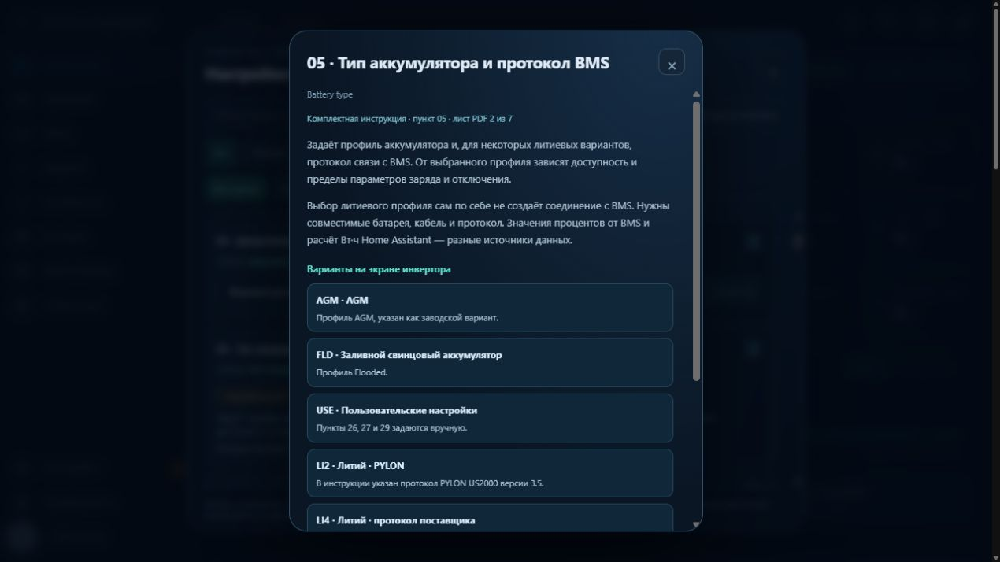

# Меню ANENJI за комплектною інструкцією

Каталог 2.15.0 звірено з усіма сімома сканованими аркушами, які надав власник. Повний PDF та його фотографії до публічного репозиторію не додаються. Пояснення в інтерфейсі написано російською своїми словами; збережено номери пунктів, LCD-коди, діапазони та залежності. Пропуски в нумерації відповідають самій інструкції.

## Пункти інструкції

- **01** — пріоритет живлення: UTI, SOL, SBU, SUB, SUF.
- **02** — максимальний сумарний струм заряджання.
- **03** — діапазон вхідної напруги: APL, UPS, GEN.
- **05** — тип АКБ і протокол BMS: AGM, FLD, USE, LI2, LI4, LIB.
- **06** — автоматичний запуск після перевантаження.
- **07** — автоматичний запуск після перегрівання.
- **08** — номінальна вихідна напруга.
- **09** — вихідна частота; зміна заборонена власником.
- **10** — автоматичний мережевий байпас.
- **11** — максимальний струм заряджання від мережі.
- **12** — повернення до мережі за напругою АКБ.
- **13** — повернення до АКБ за напругою; окремо пояснено FUL.
- **16** — джерела заряджання: CSO, SNU, OSO.
- **18** — режими звукових сигналів MD1–MD4.
- **19** — повернення LCD на основну сторінку.
- **20** — підсвічування LCD.
- **23** — байпас при перевантаженні.
- **25** — адреса пристрою Modbus.
- **26** — напруга основного заряджання C.V.
- **27** — напруга підтримувального заряджання.
- **29** — автономне відключення за напругою АКБ.
- **32** — тривалість стадії C.V; AUT або 5–900 хвилин.
- **33** — дозвіл вирівнювального заряджання.
- **34** — напруга вирівнювання.
- **35** — тривалість вирівнювання.
- **36** — граничний час спроби вирівнювання.
- **37** — інтервал вирівнювань.
- **39** — негайна активація вирівнювання.
- **41** — автоматичне пробудження літієвої АКБ.
- **42** — ручна активація літієвої АКБ.
- **43** — повернення до мережі за SOC батареї.
- **44** — повернення до АКБ за SOC батареї.
- **45** — автономне відключення за SOC.
- **46** — захист за струмом розряджання.
- **48** — тривалість активації літієвої АКБ.

## Керування та довідка

Звичайні поля збережено для існуючих елементів керування EyeBond Local. Каталог не змінює адреси регістрів, діапазони або варіанти команд і не вмикає додаткових записів у прошивку.

Пункти **05, 10, 25, 32, 39, 41, 42, 43, 44, 45, 46, 48** не мають відповідного дистанційного елемента керування у використаному профілі інтеграції. Їхні картки показано з позначкою «Настройка на LCD» та кнопкою i. Якщо вже існує сенсор із фактичним значенням, воно відображається; за відсутності даних видно «Не передаётся», без вигаданого стану. Налаштовувати їх можна на фізичному екрані за інструкцією. Якщо в майбутньому інтеграція надасть відповідний number/select/switch, картка використає його автоматично.

Пункт 03 у паперовій інструкції має також GEN, але дистанційний список використовує тільки реальні варіанти інтеграції. Аналогічно, FUL у пункті 13 не перетворюється на довільне числове значення. Відмінності між назвою Timed Off у протоколі та Backlight Off у книзі пояснено окремо.

Параметри схеми інверторів, енергозбереження, способу локального/дистанційного ввімкнення та захисту від перенапруги АКБ, яких немає на наданих аркушах, залишено після нумерованих пунктів з позначкою «Дополнительный параметр интеграции». Номерів їм не вигадано.

## Як читати довідку

Пошук розуміє `5` або `05` як точний номер, а також назви й коди на зразок LIB чи CSO. Фільтр «Онлайн» показує об’єкти керування інтеграції, «На LCD» — пункти без дистанційного редактора. Поточна заборона запису, відсутність зв’язку або блокування частоти продовжують діяти навіть для об’єкта у фільтрі «Онлайн».

За i відкриваються призначення, варіанти на LCD, залежності, посилання на інші номери й аркуш джерела. Діапазони з паперової таблиці наведено як довідку. Запис перевіряється за поточними межами інтеграції, пов’язаними порогами і відповіддю прошивки. Заводські значення з книги не встановлюються автоматично та не є рекомендаціями для конкретної АКБ.

У пункті 34 інструкція містить суперечність: для LIB наведено заводські 29,2 В, але верхня границя в цьому ж рядку — 29 В. У довідці це явно зазначено, обхід обмежень не додається.

Для пункту 46 пояснено, що за відсутності мережі книга описує попередження з продовженням розряджання. Це не обіцянка жорсткого обмеження струму. Ілюстрація 500 А не є рекомендованим значенням. Підтверджений власником ліміт розряджання його BMS — 100 А; він не означає дозвіл заряджати таким самим струмом.

SOC батареї з пунктів 43–45 відділено від обліку Вт·год у Home Assistant. Вирівнювання відділено від балансування літієвої BMS, а пробудження — від калібрування залишку енергії.

[Меню на телефоні](screenshots/manual-numbered-mobile.jpg).
